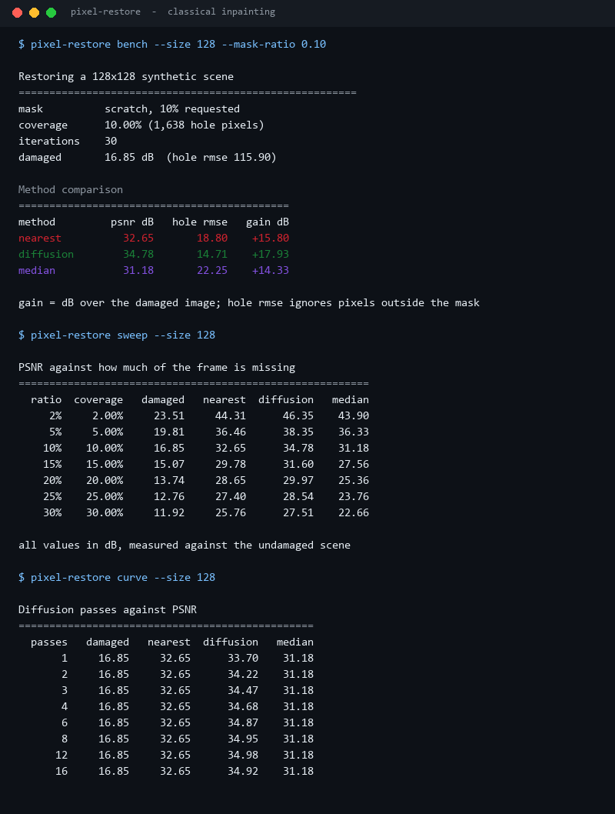
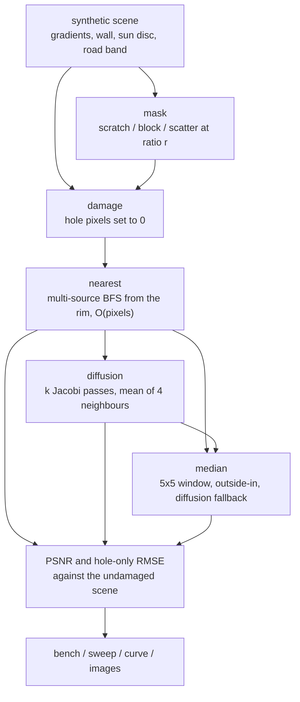
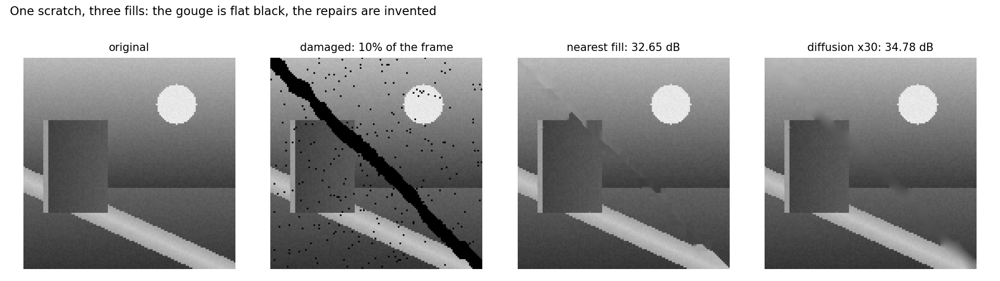
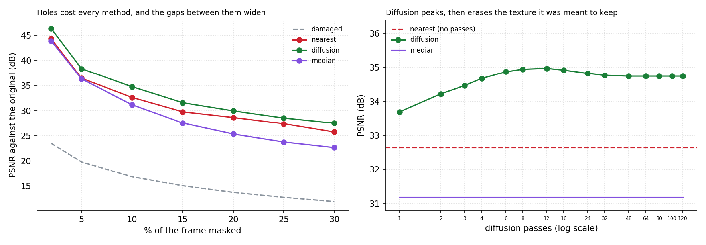

# Pixel-Restore-Lab

**Three classical inpainting fills, scored with PSNR against a mask size you control, so you can see exactly how much of a hole a nearest-pixel copy, a diffusion pass and a median filter can actually invent.**



All numbers come from `scripts/render_assets.py` running this repository's code on a deterministic
128×128 synthetic scene. No Pillow, no numpy, no learned model: the PNG encoder is `zlib` plus
`struct` in `src/pixel_restore_lab/image.py`.

---

## Table of contents

- [Why this exists](#why-this-exists)
- [The restore pipeline](#the-restore-pipeline)
- [What the damage looks like](#what-the-damage-looks-like)
- [Damaged against three fills](#damaged-against-three-fills)
- [Mask shape decides the winner](#mask-shape-decides-the-winner)
- [How much can go missing](#how-much-can-go-missing)
- [Where diffusion peaks](#where-diffusion-peaks)
- [Install and run](#install-and-run)
- [Commands](#commands)
- [Design notes and limits](#design-notes-and-limits)
- [Tests](#tests)
- [License](#license)

---

## Why this exists

Every image editor ships a "heal" brush, and every one of them is now advertised as AI. The
boring, deterministic half of that problem is worth measuring on its own: given a mask and a
damaged image, how good is a fill that only ever copies and averages *known* neighbours? Three
answer candidates are compared here on identical damage:

- **nearest** - copy each hole pixel from the nearest known pixel (multi-source BFS from the hole
  rim), which is the cheapest thing that produces a plausible-looking image;
- **diffusion** - Jacobi relaxation on the holes: each pass replaces every hole pixel with the mean
  of its four neighbours, holding the known pixels fixed, so the fill converges towards a smooth
  interpolation of the boundary;
- **median** - fill each hole with the median of the already-restored pixels in a 5×5 window,
  working inward from the rim, falling back to the diffusion estimate where the window is too thin.

The damaged image handed to every method has its holes painted flat black, and nothing downstream
ever reads the original under the mask. That is asserted by a test, not by good intentions.

## The restore pipeline



`nearest` is O(width × height): the queue visits each hole pixel once, so a 128×128 frame with 10%
missing costs the same order of work as reading the pixels. `diffusion` reuses that fill as its
starting point - it is the best cheap guess available - and never touches the damaged values.
`median` also starts from the diffusion buffer, so all three methods share one code path for
"what is the value of a pixel we are not allowed to look at".

## What the damage looks like



Four panels, all written by the encoder in this repository at 3× nearest-neighbour zoom: the scene
(128×128), the same scene with a 10% scratch, the nearest fill and the diffusion fill at 30 passes.
The scratch is flat black, so the damage is not hiding anything subtle; the interesting part is
how much of the wall edge, the road band and the sun disc each fill manages to put back.

## Damaged against three fills

A 10% diagonal scratch, 30 diffusion passes, on the 128×128 scene:

| Method | PSNR | Hole RMSE | Gain over damaged |
| --- | ---: | ---: | ---: |
| damaged (holes painted black) | 16.85 dB | 115.90 | - |
| nearest | 32.65 dB | 18.80 | **+15.80 dB** |
| diffusion | **34.78 dB** | **14.71** | **+17.93 dB** |
| median | 31.18 dB | 22.25 | +14.33 dB |

`Gain` is measured in dB against the damaged image, so the whole table collapses to one sentence:
copying from the nearest known pixel already recovers 15.8 dB on a scratch, and thirty diffusion
passes add another 2.1 dB on top of that. The hole-only RMSE tells the same story from the other
direction - 116 grey levels of error per hole pixel become 14.7.

## Mask shape decides the winner

Same 10% of the frame, same 128×128 scene, 30 passes, three kinds of damage:

| Mask | Damaged | nearest | diffusion | median |
| --- | ---: | ---: | ---: | ---: |
| scratch (a band plus dust) | 16.85 dB | 32.65 | **34.78** | 31.18 |
| block (rectangles) | 14.85 dB | 26.81 | **29.20** | 25.38 |
| scatter (specks and 3×3 blobs) | 16.33 dB | 38.74 | **40.65** | 39.19 |

Two observations worth keeping:

- **Scattered damage is the easy case.** Isolated specks always have known pixels on every side, so
  even the nearest fill lands within 9.3 grey levels and scores 38.74 dB. A contiguous gouge is the
  hard case: the middle of a band has no neighbours to copy from, which is why the block column is
  11.5 dB worse than the scatter column for the same amount of missing area.
- **The median filter only closes the gap when the holes are small.** On scattered specks it is
  within 1.5 dB of diffusion; on a wide scratch it loses to plain nearest-pixel copying by 1.5 dB,
  because a median over a 5×5 window on a diagonal gradient band biases each pixel along the band
  instead of across it. That is the honest result - medians are salt-and-pepper filters, not
  inpainting.

## How much can go missing



| Masked | damaged | nearest | diffusion | median |
| ---: | ---: | ---: | ---: | ---: |
| 2% | 23.51 dB | 44.31 | **46.35** | 43.90 |
| 5% | 19.81 dB | 36.46 | **38.35** | 36.33 |
| 10% | 16.85 dB | 32.65 | **34.78** | 31.18 |
| 15% | 15.07 dB | 29.78 | **31.60** | 27.56 |
| 20% | 13.74 dB | 28.65 | **29.97** | 25.36 |
| 25% | 12.76 dB | 27.40 | **28.54** | 23.76 |
| 30% | 11.92 dB | 25.76 | **27.51** | 22.66 |

At 2% coverage a classical fill is essentially free: 46.35 dB is above what most lossy compression
artefacts cost. The interesting number is the slope. Going from 2% to 30% of the frame costs
diffusion 18.8 dB and nearest 18.6 dB, but median 21.2 dB - the median's lead over a simple copy
disappears exactly when the holes stop being small. The gap between diffusion and nearest stays
roughly constant at 1.1-2.1 dB, so most of the benefit of relaxation is available at every mask
size, not just at the small end.

## Where diffusion peaks

| Passes | 1 | 3 | 6 | 12 | 24 | 48 | 120 |
| --- | ---: | ---: | ---: | ---: | ---: | ---: | ---: |
| diffusion | 33.70 dB | 34.47 | 34.87 | **34.98** | 34.83 | 34.75 | 34.75 |

Nearest, for reference, is flat at 32.65 dB and the median fill is flat at 31.18 dB - neither cares
about the iteration count.

The curve peaks at **12 passes** and then gives back 0.23 dB by 48 passes, where it plateaus. That
is the classic failure of pure relaxation: past the point where the fill has interpolated the
boundary, further passes keep averaging and start erasing the texture that was there. Since the
scene has ±4 levels of deterministic noise, the plateau is the noise-free harmonic solution, and it
is *worse* than stopping early. Default `--iterations 30` is deliberately a little past the peak -
it is a comfortable setting across mask sizes rather than a tuned maximum.

## Install and run

Standard library only at runtime (`image`, `masks`, `restore`, `metrics`, `report`, `cli`, `bench`).

```bash
python -m pip install -e ".[dev]"
pixel-restore bench --size 128 --mask-ratio 0.10
```

From a checkout without installing:

```bash
PYTHONPATH=src python -m pixel_restore_lab bench --size 128
```

The `dev` extra adds pytest, ruff, Pillow and matplotlib. The last two are used **only** by
`scripts/render_assets.py`; nothing under `src/` or `tests/` imports them.

## Commands

| Command | What it answers |
| --- | --- |
| `bench --size --mask-ratio --mask --iterations` | damaged PSNR against all three methods, once |
| `sweep --size` | PSNR per method as the mask ratio runs 2% → 30% |
| `curve --size` | PSNR against diffusion passes, 1 → 120 |
| `images --out DIR` | write `original`, `damaged`, `nearest`, `diffusion`, `median` PNGs |

`bench`, `sweep` and `curve` take `--format json`; every command exits 2 with `error: ...` on
stderr when a parameter makes no sense (a ratio outside (0, 1), a frame smaller than 16 pixels, a
zero scale).

## Design notes and limits

- **This is classical inpainting, not learned priors.** There is no model, no training set and no
  patch dictionary. Diffusion solves a Laplace problem on the holes; median filters a window;
  nearest copies. A learned method can hallucinate a plausible texture where these three will
  always produce a smooth blob, and that difference is the whole reason the learned methods exist.
- **PSNR rewards smoothness.** Diffusion wins here partly because PSNR is a per-pixel squared error:
  a smooth fill that erases texture is *cheaper* than a sharp fill that guesses the texture wrong.
  The iteration curve shows the effect directly (34.98 dB at 12 passes, 34.75 dB at 120). Any
  eyeball or perceptual metric will prefer less smoothing than the peak of that curve, which is why
  the panels image uses 30 passes and not 120.
- **The mask generators are exact, not approximate.** Each one takes the requested pixel budget and
  fills it exactly, so coverage equals the requested ratio to the pixel; the test still asserts the
  agreement is within 10%, which is the tolerance the CLI parameters promise.
- **The damaged image is flat black inside the holes**, which is a harsher starting point than a
  real gouge in a photograph (where neighbouring texture leaks in). It makes the damaged PSNR
  uselessly low on purpose, and it makes "did the method cheat" trivially checkable: restore the
  same mask over black holes and over white holes and compare the results byte for byte.
- **The PNG encoder is intentionally minimal**: 8-bit greyscale, colour type 0, one IDAT, filter
  type 0 on every row. `read_png_size` parses IHDR and validates its CRC, which is how the tests -
  and the asset script, before it hands a file to Pillow - prove the bytes are a real PNG.
- **One scene, one seed.** The synthetic frame is a gradient sky, a dark wall, a sun disc, a road
  band and ±4 levels of deterministic noise. Real photographs have far more texture, so the
  absolute dB values here are optimistic for anything but a smooth region. The relative ranking is
  what travels.

## Tests

```bash
PYTHONPATH=src python -m pytest -q     # 56 passed
python -m ruff check .                 # All checks passed!
```

56 tests cover the raster and PNG contract (signature, IHDR dimensions and flags, filter-0
scanlines, IEND, CRC validation, nearest-neighbour upscaling), mask coverage accuracy and
determinism for all three generators, the "never read the hole pixels" guarantee, each method
reducing hole-only RMSE on each mask family, PSNR and RMSE against closed-form values (`inf` for
identical images, 60.17 dB for one level of error in 16 pixels), and every CLI subcommand
including exit code 2 and the files written by `images`.

## License

MIT. See [LICENSE](LICENSE).

---

<sub>Screenshots and charts are generated by `scripts/render_assets.py` from this repository's own
output, including the PNGs it hands to Pillow for the panel strip. No third-party data or images are
used.</sub>
